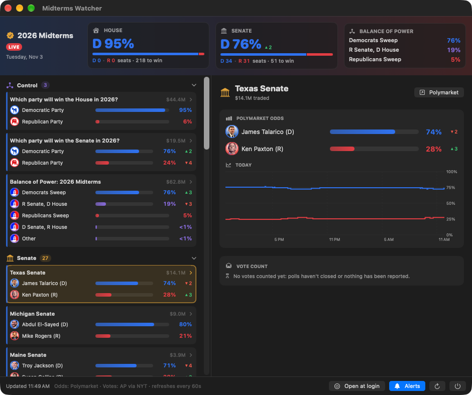

# Midterms Watcher

A small macOS menu bar app for watching the 2026 US midterms on election night. It puts [Polymarket](https://polymarket.com) odds next to live AP vote counts in one panel.



- **Menu bar:** House and Senate control odds at a glance (`🏛 H D95 S D76`)
- **Header:** chamber control odds with 24h change, live seats won vs. seats needed, and balance-of-power scenarios
- **Race list:** every Senate, Governor and House race on Polymarket, sorted by volume, with candidate photos, odds bars and "% in" vote counts once counting starts
- **Race detail:** all outcomes, today's odds chart, the AP vote count with % of expected vote, and a vote-share-over-time chart
- **Notifications:** 5-point odds swings, a new favorite, and AP race calls
- Refreshes every 60 seconds. Single Swift file with no dependencies, universal binary (Apple Silicon and Intel).

## Install

Requires macOS 14 (Sonoma) or later.

**Option 1: download.** Grab [**MidtermsWatcher.dmg**](https://github.com/frenchie4111/midterms-watcher/releases/latest/download/MidtermsWatcher.dmg), open it, and drag **Midterms Watcher** into Applications. Launch it from Applications or Spotlight. It's signed and notarized, so it opens without Gatekeeper warnings.

**Option 2: one-line install.**

```bash
curl -fsSL https://raw.githubusercontent.com/frenchie4111/midterms-watcher/main/install.sh | bash
```

This downloads the latest release into `/Applications` and launches it.

**Option 3: build from source** (needs Xcode Command Line Tools: `xcode-select --install`):

```bash
git clone https://github.com/frenchie4111/midterms-watcher.git
cd midterms-watcher
./install.sh --from-source
```

After launching, look for the 🏛 in your menu bar and allow notifications when asked. Click **Open at login** in the panel footer to start it automatically.

**Uninstall:** quit it from the ⏻ button, then delete the app. Or run `curl -fsSL https://raw.githubusercontent.com/frenchie4111/midterms-watcher/main/install.sh | bash -s -- --uninstall`.

## Data sources

| What | Source |
|---|---|
| Odds, 24h change, volume | Polymarket [Gamma API](https://gamma-api.polymarket.com) (events tagged `midterms`) |
| Today's odds chart | Polymarket CLOB `prices-history` |
| Vote counts, % expected vote, race calls, seat tallies | AP results via the New York Times' public results JSON |

Neither source publishes a vote-count history. The app records a snapshot each time a race's count changes, to `~/Library/Application Support/MidtermsWatcher/`. The vote-share chart only covers the time the app has been running, so leave it open.

Polymarket races are matched to results by state for Senate and Governor races. House district races show odds only.

## Development

```bash
./build.sh                                   # ad-hoc signed build in build/
"build/Midterms Watcher.app/Contents/MacOS/MidtermsWatcher" --window   # panel in a regular window
```

Debug environment variables:
- `MIDTERMS_RESULTS_DATE=2024-11-05` exercises the vote UI against 2024's results.
- `MIDTERMS_SELECT=<polymarket-event-slug>` preselects a race.

Releasing: bump `CFBundleShortVersionString` in `Info.plist`, then run `./release.sh`. It builds, signs with Developer ID, and notarizes. Notarization needs `APPLE_ID`, `APPLE_APP_SPECIFIC_PASSWORD` and `APPLE_TEAM_ID` in the environment, or a keychain profile from `./release.sh --setup-notary`. Then run the `gh release create` command it prints.

## License

MIT. Not affiliated with Polymarket, the AP or the New York Times. Odds are not predictions or advice.
